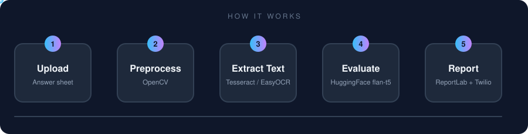
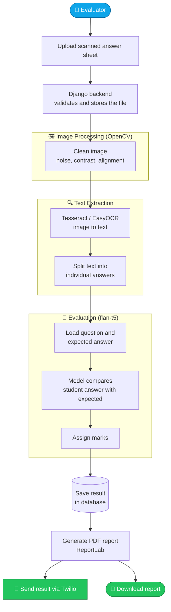

<div align="center">



<br/>


**Upload an answer sheet. Get a graded report. No manual checking.**

[Source Code](https://github.com/deepakbharti-cloud/AutoGrade-AI) · [Report an Issue](https://github.com/deepakbharti-cloud/AutoGrade-AI/issues) · [Developer](#developer)

</div>

---

<div align="center">

### 🧭 Quick Navigation

<sub>Click any button to jump to that section</sub>

<p>
<a href="#overview"></a>
<a href="#features"></a>
<a href="#how-it-works"></a>
<a href="#workflow"></a>
<a href="#tech-stack"></a>
</p>
<p>
<a href="#getting-started"></a>
<a href="#roadmap"></a>
<a href="#team"></a>
<a href="#contributing"></a>
<a href="#developer"></a>
</p>

</div>

---

<a id="overview"></a>

## 📖 Overview

Grading answer sheets by hand is slow, repetitive and inconsistent from one evaluator to the next. **AutoGrade AI** automates the process. It takes a scanned answer sheet, cleans up the image, reads the text with OCR, evaluates the answers with a language model, and produces a graded PDF report.

It is a team project built with **Django**, with image processing, OCR and NLP working together in one pipeline.

---

<a id="features"></a>

## ✨ Features

| | Feature | What it does |
|---|---|---|
| 🖼️ | **Image preprocessing** | Cleans scanned sheets with OpenCV (noise, contrast, alignment) before text extraction |
| 🔍 | **OCR extraction** | Reads answer text using Tesseract / EasyOCR |
| 🧠 | **AI evaluation** | Scores answers with a HuggingFace flan-t5 model |
| 📄 | **PDF reports** | Generates a result report with ReportLab |
| 📲 | **Notifications** | Sends results through Twilio |
| 🔐 | **Django backend** | Handles uploads, users and result storage |

---

<a id="how-it-works"></a>

## 🔁 How It Works

<div align="center">

</div>

1. **Upload:** the evaluator uploads a scanned answer sheet.
2. **Preprocess:** OpenCV cleans and normalises the image so the text is easier to read.
3. **Extract text:** OCR converts the image into text.
4. **Evaluate:** the language model compares the extracted answer with the expected answer and assigns marks.
5. **Report:** a PDF report is generated and the result can be sent out via Twilio.

---

<a id="workflow"></a>

## 🧭 Workflow

<div align="center">

</div>

| Step | Lane | What happens |
|:---:|---|---|
| 1 | 👤 Evaluator | Uploads the scanned answer sheet |
| 2 | 🟣 Django backend | Validates the file and stores it |
| 3 | 🟢 AI engine | OpenCV cleans and normalises the image |
| 4 | 🟢 AI engine | OCR converts the image into text |
| 5 | 🟢 AI engine | The flan-t5 model evaluates the answers and produces marks |
| 6 | 🟣 Django backend | Saves the marks in the database |
| 7 | 🟣 Django backend | Builds the PDF report (ReportLab) and sends an alert (Twilio) |
| 8 | 👤 Evaluator | Views the result and receives the alert |

<details>
<summary><b>🔬 See the detailed flowchart</b></summary>



</details>

---

<a id="tech-stack"></a>

## 🛠️ Technology Stack

| Layer | Technology | Purpose |
|---|---|---|
| Language | Python 3 | Core development |
| Backend | Django | Web framework, routing, admin, storage |
| Image processing | OpenCV | Preprocessing of scanned sheets |
| OCR | Tesseract / EasyOCR | Text extraction |
| NLP | HuggingFace Transformers (flan-t5) | Answer evaluation |
| Reports | ReportLab | PDF result generation |
| Messaging | Twilio | Result notifications |
| Version control | Git & GitHub | Source management |

---

<a id="getting-started"></a>

## ⚙️ Getting Started

### Prerequisites

- Python 3.10+
- Git
- [Tesseract OCR](https://github.com/tesseract-ocr/tesseract) installed on your system (needed for the Tesseract path)
- A [Twilio](https://www.twilio.com/) account (only if you want notifications)

### 1. Clone the repository

```bash
git clone https://github.com/deepakbharti-cloud/AutoGrade-AI.git
cd AutoGrade-AI
```

### 2. Create a virtual environment

**Windows (PowerShell):**

```powershell
python -m venv .venv
.\.venv\Scripts\Activate.ps1
```

**macOS / Linux:**

```bash
python3 -m venv .venv
source .venv/bin/activate
```

### 3. Install dependencies

```bash
pip install -r requirements.txt
```

> The flan-t5 model is downloaded from HuggingFace on the first run, so the first evaluation takes longer.

### 4. Configure environment variables

Create a `.env` file in the project root:

```env
SECRET_KEY=your-django-secret-key
DEBUG=True
TWILIO_ACCOUNT_SID=your-twilio-sid
TWILIO_AUTH_TOKEN=your-twilio-token
TWILIO_PHONE_NUMBER=your-twilio-number
```

> Never commit `.env` or any real credentials to GitHub.

### 5. Run migrations and start the server

```bash
python manage.py migrate
python manage.py createsuperuser
python manage.py runserver
```

Open **http://127.0.0.1:8000/** in your browser.

---

<a id="roadmap"></a>

## 🗺️ Roadmap

- [x] Answer sheet upload and preprocessing
- [x] OCR text extraction
- [x] AI-based answer evaluation
- [x] PDF report generation
- [x] Twilio notifications
- [ ] REST API with **Django REST Framework**
- [ ] Support for handwritten answers with better OCR accuracy
- [ ] Teacher dashboard with class-wide analytics
- [ ] Docker setup and cloud deployment

---

<a id="team"></a>

## 👥 Team

AutoGrade AI was built by a 6-member team.

| Member | Role |
|---|---|
| **Deepak Bharti** | DIP Engineer (digital image processing) |
<!-- Add the remaining team members here, one row each:
| Name | Role |
-->

---

<a id="contributing"></a>

## 🤝 Contributing

Suggestions and improvements are welcome.

1. Fork the repository
2. Create a branch: `git checkout -b feature/your-feature`
3. Commit your changes
4. Push and open a Pull Request

---

<a id="developer"></a>

## 👨‍💻 Developer

**Deepak Bharti**

- 🌐 Portfolio: [deepakbharti.github.io](https://deepakbharti.github.io)
- 🐙 GitHub: [@deepakbharti-cloud](https://github.com/deepakbharti-cloud)
- 💼 LinkedIn: [Deepak Bharti](https://www.linkedin.com/in/deepak-bharti-ab7622315)

---

<div align="center">

Built with Python, Django and a lot of OCR · ⭐ Star the repo if you like it!

</div>
